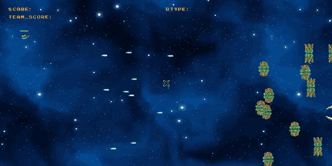
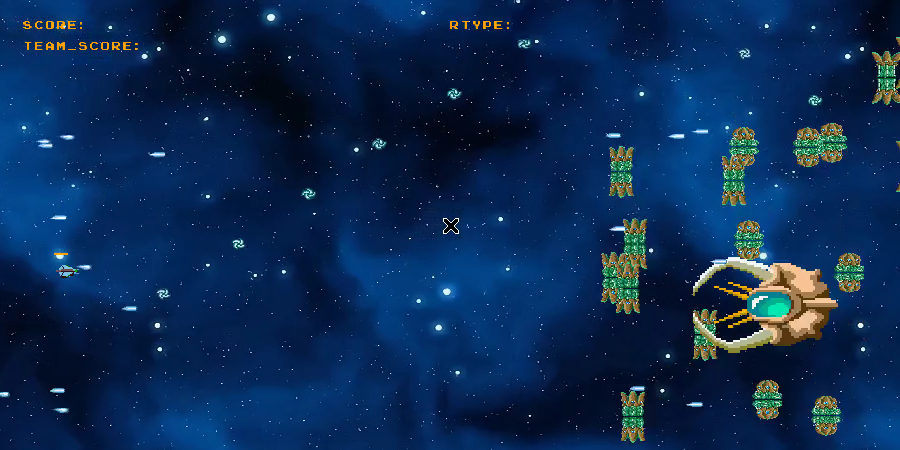

<div align="center">

# R-Type

**The classic shoot'em up, in network multiplayer, on a home-made game engine.**

     

<sub>Team of 5 · 2024</sub>

</div>

<br/>

<p align="center"></p>

## About the project

We rebuilt *R-Type* from scratch as a team of five. Most of the work is the **engine**: a generic ECS architecture and a client / server network layer, with the game built on top. Up to 4 players fight together against waves of enemies and bosses.

## Features

- **ECS engine** (Entity Component System): registry, components and systems, independent of the game
- **Client / server multiplayer** over UDP with Asio, up to 4 players
- Several levels, bosses, power-ups, individual and team scores
- Difficulty and friendly fire configurable when the server starts
- **Cross-platform** build: Linux, macOS and Windows (MinGW)
- CI that builds the project on Linux and macOS on every push

<p align="center"></p>
<p align="center"><sub>A wave of enemies, with the team score</sub></p>

## Run it

```bash
cmake -P build.cmake
cmake --build build
./rtype_server 4242 --difficulty medium --friendlyfire false
./rtype_client 127.0.0.1 4242
```

`build.cmake` downloads vcpkg and installs raylib, Asio and GLFW. On a machine where vcpkg can't download sources (for example behind a restrictive proxy), you can install Asio and GLFW from your package manager, build raylib 5.5 yourself, and point `CMAKE_PREFIX_PATH` at them.

The full technical documentation is in [DOCUMENTATION.md](DOCUMENTATION.md).

## My contribution

123 of the project's 745 commits are mine (September to November 2024). I worked on the **game logic on the ECS side**, and a bit on networking:

- **Levels and bosses**: the level-switching system, the bosses of levels 2 and 3 (the final boss is made of four ships), boss-specific firing patterns, including a missile that follows the player
- **ECS systems**: `BossSpawnSystem`, `BossFiringSystem`, respawn of enemy waves, collisions between the boss and friendly entities
- **Server**: one thread per connected client, and the first version of the UDP client
- **Assets and documentation**: sprites for the boss and the new enemies, documentation of the systems I added

## Team

<a href="https://github.com/Chaegnal/r-type/graphs/contributors"></a>

Yanis Harkouk, Mathis Brehm, Eva Legrand, Wilson Bordichon, Edouard Bocquet
